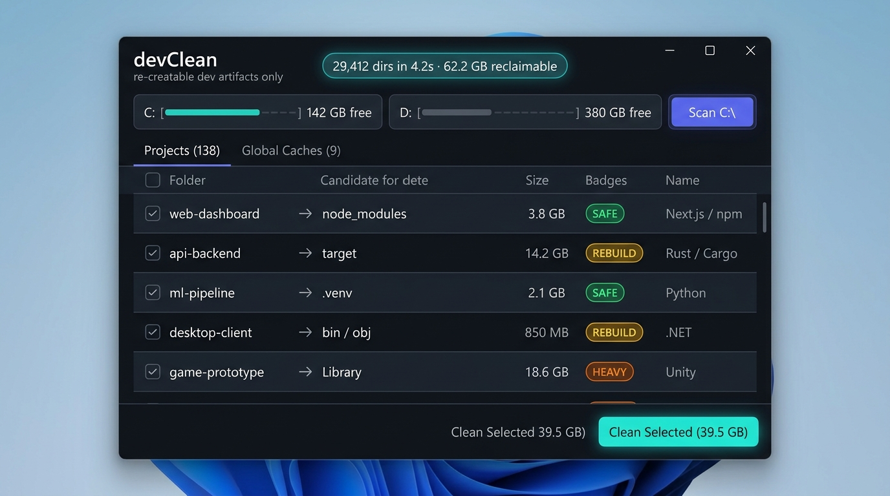
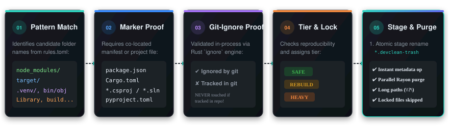

<div align="center">


# devClean

**Blazing-fast, zero-risk developer disk cleaner crafted for Windows**

*Reclaim tens of gigabytes of re-creatable artifacts — `node_modules`, `target`, `.venv`, build outputs, and package caches.*

<p>
  <a href="LICENSE"></a>
  
  
  
  
  
</p>

---

<p>
  <a href="#-about-devclean">About</a> •
  <a href="#-key-features">Features</a> •
  <a href="#-visual-tour">Visual Tour</a> •
  <a href="#-safety-model--tiers">Safety Model</a> •
  <a href="#-supported-ecosystems">Ecosystems</a> •
  <a href="#-installation--usage">Usage</a> •
  <a href="#-performance--benchmarks">Benchmarks</a> •
  <a href="#-building-from-source">Building</a> •
  <a href="#-design-philosophy">Design</a> •
  <a href="#-license">License</a>
</p>

<picture>
  
</picture>

</div>

---

## 🧹 About devClean

Every developer's drive silently drowns under gigabytes of forgotten build outputs, virtual environments, intermediate tool files, and global package stores: hundreds of `node_modules` folders, multi-gigabyte Rust `target/` directories, Python `.venv` trees, C# `bin/obj` dumps, and bloated tool caches.

Standard disk cleanup tools do not understand codebases. They either miss developer folders entirely or recklessly delete directories based purely on names like `dist` or `build`, endangering hand-authored assets.

**devClean** solves this with a **zero-risk verification engine**:

- ⚡ **Pure Rust Engine**: Sub-second folder discovery, zero runtime overhead, no garbage collection pauses, and multi-core directory enumeration.
- 🛡️ **Enforced Zero-Risk Safety**: Nothing is matched by name alone. Candidates are only eligible when an unambiguous project marker exists (`package.json`, `Cargo.toml`, `*.csproj`), the directory is confirmed `.gitignore`d, and dependencies have a lockfile backing reproducible reinstalls.
- 🚀 **Instant Staging Deletion**: Deleting 200,000 files in Windows normally freezes Explorer or takes minutes in the Recycle Bin. devClean atomically renames candidate trees into a hidden staging trash in a single metadata tick, then purges them asynchronously in parallel.
- 🪟 **Crafted for Windows**: Native Windows 11 acrylic interface powered by Tauri v2 and React 19, plus a feather-weight 1.6 MB CLI tool built for scripts and automated Task Scheduler maintenance.
- 📦 **Dual-Scope Cleaning**: Reclaims space from active project directories across 15+ ecosystems and scrubs system-wide package caches (npm, pnpm, Cargo, pip, NuGet, Gradle, Go, Hugging Face, JetBrains, and more).

---

## ✨ Key Features

<table>
  <tr>
    <td width="50%">
      <h3>🛡️ Enforced Zero-Risk Verification</h3>
      <p>Multi-stage verification guarantees safety: rule match + marker verification + in-process git-ignore proof + lockfile validation. Git-tracked files are <b>never touched</b>.</p>
    </td>
    <td width="50%">
      <h3>⚡ Blazing-Fast Parallel Walk</h3>
      <p>Prune-on-match traversal bypasses recursive walking inside candidate trees. Scans an entire drive with 29,000+ folders in under <b>4.2 seconds</b>.</p>
    </td>
  </tr>
  <tr>
    <td width="50%">
      <h3>🎯 Granular Safety Tiers</h3>
      <p>Clean with complete peace of mind using categorized tiers: <b>Safe</b> (exact lockfile reinstall), <b>Rebuild</b> (compiled outputs), and <b>Heavy</b> (slow caches like Unity Library).</p>
    </td>
    <td width="50%">
      <h3>📦 Universal Cache Management</h3>
      <p>Scrub 20+ global tool caches including npm, pnpm, Cargo, pip, uv, NuGet, Gradle, Go, and Hugging Face models using tool-native cleanup commands whenever available.</p>
    </td>
  </tr>
  <tr>
    <td width="50%">
      <h3>💨 Instant Staging Architecture</h3>
      <p>Eliminate deletion lag. Folders are instantly moved to <code>&lt;drive&gt;\.devclean-trash</code> with a single atomic metadata operation, then purged concurrently in the background.</p>
    </td>
    <td width="50%">
      <h3>💻 Desktop GUI + Featherweight CLI</h3>
      <p>Enjoy a sleek, dark-mode Windows 11 desktop app with live drive meters, or use the standalone 1.6 MB <code>devclean.exe</code> CLI for CI/CD and Task Scheduler jobs.</p>
    </td>
  </tr>
</table>

---

## 📸 Visual Tour

### 1. High-Performance Desktop Interface
Inspect, filter, and selectively purge candidates by project, age, ecosystem, and reclaimable size. Real-time disk space meters poll directly via kernel queries to reflect freed bytes as files vanish.

<p align="center">
  
</p>

### 2. The Zero-Risk Verification Funnel
Every directory must successfully pass through devClean's five-stage verification pipeline before it can ever be scheduled for deletion:

<p align="center">
  
</p>

### 3. Real-Time Safety &amp; Lock Protections
- **Junction & Symlink Immunity**: Reparse points and symlinks (such as `pnpm` junction stores) are removed strictly as links and are never traversed.
- **In-Use File Tolerance**: If an IDE or compiler process holds a file open, devClean logs the locked resource without terminating the purge job.
- **Crash Recovery**: If a purge is interrupted, the next scan identifies orphaned `.devclean-trash` staging folders and cleanly re-stages them for removal.

---

## 🛡️ Safety Model &amp; Tiers

### Deletion Tiers

| Tier | Classification | Verification Criteria | Reinstall / Recovery Cost |
|:---|:---|:---|:---|
| 🟢 **Safe** | Pure dependencies & caches | Project marker + git-ignored + valid lockfile | Exact byte-for-byte reinstall (`npm ci`, `cargo build`) |
| 🟡 **Rebuild** | Build outputs & artifacts | Project marker + git-ignored | Recompilation time (e.g. `target/`, `dist/`, `bin/obj/`) |
| 🟠 **Heavy** | Large regenerable assets | Project marker + explicit opt-in | High bandwidth / long re-index (e.g. Unity `Library`, Unreal DDC) |

### The "Never Touched" Blacklist

devClean enforces hard exclusions at the scanner core:
- **Git-Tracked Content**: Any file or directory tracked in a Git index is strictly immutable.
- **Repository Metadata**: `.git/`, `.hg/`, `.svn/` roots are completely skipped.
- **System & OS Trees**: `C:\Windows`, `Program Files`, `Program Files (x86)`, `$Recycle.Bin`, `System Volume Information`, and `AppData\Local\Packages` are ignored during project scans.
- **Developer Settings**: `.vscode/`, `.idea/`, `.vs/`, Go `vendor/`, and Unreal `Saved/` are preserved.
- **Unverified Dependencies**: Any dependency folder lacking both a valid lockfile and `.gitignore` proof is rejected.

---

## 🌐 Supported Ecosystems

Rules live in the embedded [`rules.toml`](rules.toml) configuration. Adding or updating rules is declarative:

| Ecosystem | Cleanable Targets | Verification Marker | Default Tier |
|:---|:---|:---|:---|
| **Node.js / JS / TS** | `node_modules`, `.next`, `.nuxt`, `.svelte-kit`, `.astro`, `.turbo`, `.parcel-cache`, `.angular`, `.expo`, `storybook-static`, `dist`, `build`, `out` | `package.json` | 🟢 Safe / 🟡 Rebuild |
| **Rust / Tauri** | `target` | `Cargo.toml` | 🟡 Rebuild |
| **Python** | `.venv`, `venv`, `__pycache__`, `.pytest_cache`, `.mypy_cache`, `.ruff_cache`, `.tox`, `*.egg-info` | `pyproject.toml`, `requirements*.txt`, `pyvenv.cfg` | 🟢 Safe |
| **.NET / C#** | `bin`, `obj` | `*.csproj`, `*.fsproj`, `*.sln` | 🟡 Rebuild |
| **Java / Kotlin** | `target`, `build`, `.gradle` | `pom.xml`, `build.gradle`, `build.gradle.kts` | 🟡 Rebuild |
| **C / C++** | CMake build directories | `CMakeCache.txt` | 🟡 Rebuild |
| **Flutter / Dart** | `build`, `.dart_tool` | `pubspec.yaml` | 🟡 Rebuild |
| **PHP** | `vendor` | `composer.json` + `composer.lock` | 🟢 Safe |
| **Elixir** | `_build`, `deps` | `mix.exs` | 🟢 Safe / 🟡 Rebuild |
| **Haskell** | `.stack-work`, `dist-newstyle` | `stack.yaml`, `*.cabal` | 🟡 Rebuild |
| **Zig** | `.zig-cache`, `zig-cache`, `zig-out` | `build.zig` | 🟡 Rebuild |
| **Unity** | `Library`, `Temp`, `Obj`, `Logs` | `ProjectSettings/ProjectVersion.txt` | 🟠 Heavy / 🟡 Rebuild |
| **Unreal Engine** | `Intermediate`, `DerivedDataCache`, `Binaries` | `*.uproject` | 🟠 Heavy / 🟡 Rebuild |
| **Godot** | `.godot` | `project.godot` | 🟡 Rebuild |
| **Terraform** | `.terraform` | `*.tf` | 🟢 Safe |

### Universal Global Caches

devClean detects and scrubs global package caches. When the owning runtime CLI is present on your `PATH`, devClean delegates to the official tool to maintain store integrity:

| Ecosystem / Tool | Cache Targets Cleaned | Method / Command Invoked |
|:---|:---|:---|
| **npm** | `%LOCALAPPDATA%\npm-cache\_cacache` | `npm cache clean --force` |
| **pnpm** | `%LOCALAPPDATA%\pnpm\store` | `pnpm store prune` |
| **Yarn** | `%LOCALAPPDATA%\Yarn\Cache` | `yarn cache clean` |
| **Bun** | `~/.bun/install/cache` | Directory purge |
| **Cargo** | `~/.cargo/registry/{cache,src}`, `~/.cargo/git/{checkouts,db}` | Safe registry cache purge (binaries untouched) |
| **pip** | `%LOCALAPPDATA%\pip\cache` | `pip cache purge` |
| **uv** | `%LOCALAPPDATA%\uv\cache` | `uv cache clean` |
| **Poetry** | `%LOCALAPPDATA%\pypoetry\Cache` | Directory purge |
| **NuGet** | `~/.nuget\packages`, `%LOCALAPPDATA%\NuGet\v3-cache` | `dotnet nuget locals all --clear` |
| **Gradle** | `~/.gradle\caches`, `~/.gradle\wrapper\dists` | Directory purge |
| **Maven** | `~/.m2\repository` | Directory purge (Heavy) |
| **Go** | `%GOMODCACHE%`, `%GOCACHE%` | `go clean -modcache`, `go clean -cache` |
| **Hugging Face** | `~/.cache\huggingface\hub` | Directory purge (Heavy) |
| **JetBrains** | `%LOCALAPPDATA%\JetBrains\*\caches` | Safe IDE cache purge (settings untouched) |
| **VS Code** | `%APPDATA%\Code\Cache`, `CachedData`, `CachedExtensionVSIXs` | Cache purge (extensions and configs preserved) |

---

## 🚀 Installation &amp; Usage

### Desktop GUI (Tauri v2)

The desktop app provides an interactive view with drive meters, candidate search, age filters, and one-click cleaning.

- **Portable Executable**: Run `devclean-app.exe` directly without installation.
- **Installer**: Run the NSIS setup wizard `devclean-setup.exe` for Start Menu and shortcut integration.

### Command-Line Interface (CLI)

The standalone CLI (`devclean.exe`) is a single 1.6 MB binary with zero external dependencies.

```powershell
# Scan directories or whole drives (dry run)
devclean scan C:\Users\Username\Projects

# Filter for projects untouched for over 30 days
devclean scan D:\ -older-than 30d

# Target specific safety tiers (default: safe,rebuild)
devclean scan C:\Work --tier safe

# Clean candidates with interactive confirmation
devclean clean C:\Work --older-than 14d

# Clean without confirmation prompt (ideal for CI / scripts)
devclean clean D:\OldProjects --yes

# List reclaimable space across global package caches
devclean caches

# Clean all safe global caches
devclean clean-caches all --yes

# Clean heavy caches by ID (e.g. Maven repository or Hugging Face hub)
devclean clean-caches maven huggingface --yes

# Print the active verification rule table
devclean rules
```

### Automation via Windows Task Scheduler

Set up a weekly background clean for forgotten build folders over 30 days old:

```powershell
# Run silently every Sunday at 02:00 AM
$Action = New-ScheduledTaskAction -Execute "C:\Tools\devclean.exe" -Argument "clean C:\Projects --older-than 30d --yes"
$Trigger = New-ScheduledTaskTrigger -Weekly -DaysOfWeek Sunday -At 2am
Register-ScheduledTask -TaskName "devClean Weekly Maintenance" -Action $Action -Trigger $Trigger
```

---

## ⚡ Performance &amp; Benchmarks

Measured on a standard Windows 11 workstation (NVMe SSD, AMD Ryzen / Intel Core):

| Metric | Measured Value | Notes |
|:---|:---|:---|
| **Full `C:\` Drive Scan** | **4.2 seconds** | 29,412 directories walked after pruning |
| **Reclaimable Space Found** | **53.9 GB** project files + **8.3 GB** global caches | 138 candidates detected across 8 ecosystems |
| **CLI Binary Size** | **1.6 MB** | Hand-rolled CLI parser, stripped symbols, fat LTO |
| **GUI App / Installer** | **6.2 MB** / **1.8 MB** | Tauri v2 with native WebView2 integration |
| **Idle Memory Footprint** | **5 MB** (CLI / Rust Core) | Lightweight native memory footprint |
| **Staging Time** | **< 1 millisecond** per folder | Instant atomic directory rename |

---

## 🛠️ Building from Source

### Prerequisites

Ensure the following tools are installed:
- **Rust (MSVC)**: 1.80+ (`rustup default stable-x86_64-pc-windows-msvc`)
- **Node.js**: v20+ and npm
- **WebView2**: Standard component on Windows 10/11

### Build Steps

1. **Clone the repository:**
   ```powershell
   git clone https://github.com/projectGloria/devCleanup.git
   cd devCleanup
   ```

2. **Run test suites:**
   ```powershell
   cargo test --workspace
   ```

3. **Build the CLI executable:**
   ```powershell
   cargo build --release -p devclean
   # Output: target/release/devclean.exe (1.6 MB)
   ```

4. **Build the Desktop GUI application:**
   ```powershell
   cd app
   npm install
   npx tauri build
   # Output: target/release/bundle/nsis/ (Installer) and devclean-app.exe
   ```

---

## 🎨 Design Philosophy

<p align="center">
  
</p>

> *"A vibrant teal-to-indigo gradient disc bearing three descending stacked bars — visualizing the satisfying collapse of accumulated developer clutter."*

- **Predictable & Non-Destructive**: A developer tool should never surprise the user. By combining lockfile requirements, Git index verification, and atomic staging, devClean guarantees that you never lose uncommitted code.
- **Zero-Bloat Binaries**: We deliberately hand-rolled argument parsing and minimized external dependencies. The CLI compiles to just 1.6 MB with LTO enabled.
- **Instant Feedback**: Disk cleanups shouldn't feel like waiting for a file transfer. Atomic staging ensures the UI responds immediately, while background threads handle file deletions quietly.

---

## 📜 License &amp; Credits

devClean is open-source software licensed under the **[MIT License](LICENSE)**.

- **Author**: devClean contributors & [projectGloria](https://github.com/projectGloria)
- **Built with**: [Rust](https://www.rust-lang.org/), [Tauri](https://tauri.app/), [React](https://react.dev/), and [Vite](https://vitejs.dev/)
- **License**: See the full [LICENSE](LICENSE) file for complete details.
