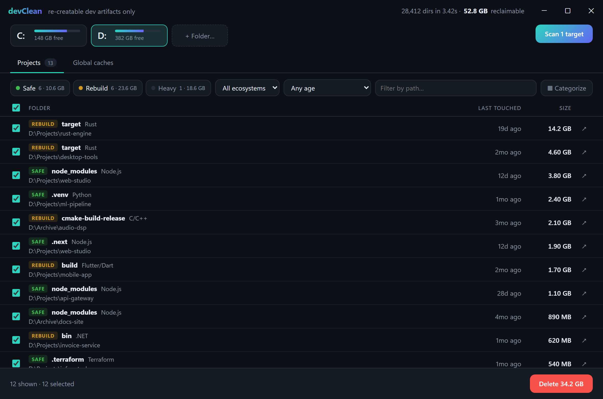
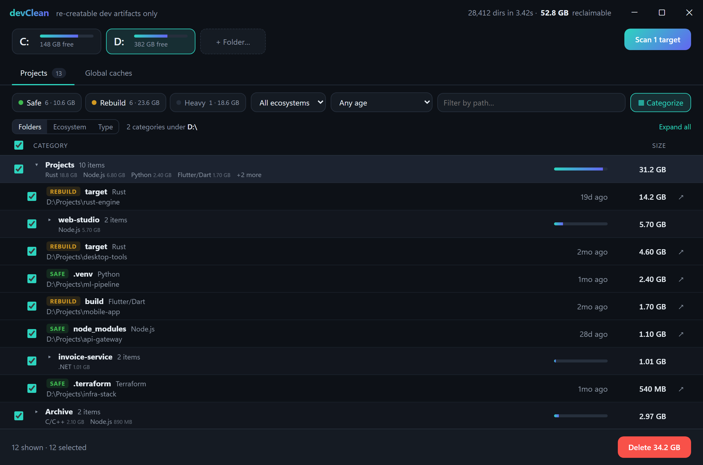
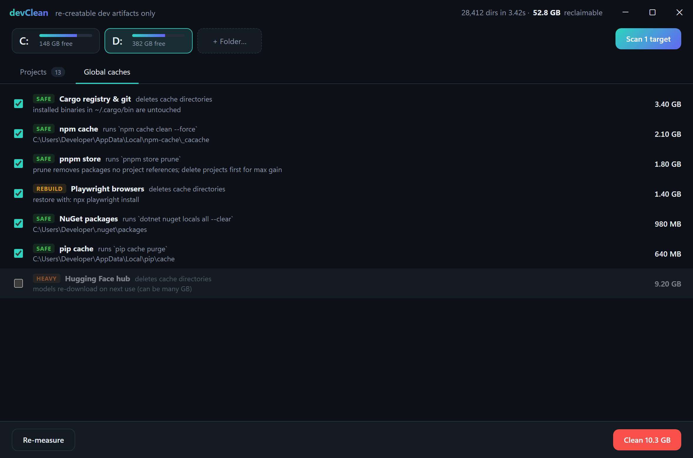
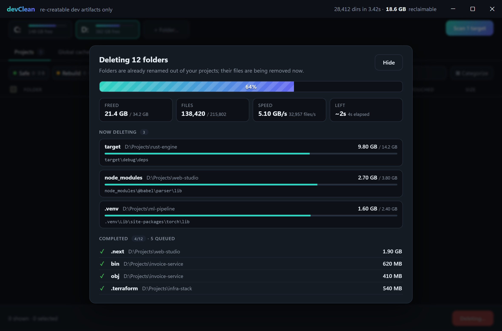
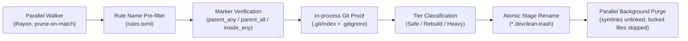

<div align="center">


# devClean

**Fast, verification-first disk cleaner for Windows developer artifacts**

Reclaim gigabytes of re-creatable `node_modules`, `target`, `.venv`, build outputs, and global package caches without risking source files.

<p>
  <a href="LICENSE"></a>
  <a href="https://github.com/projectGloria/devCleanup/actions/workflows/ci.yml"></a>
  <a href="https://github.com/projectGloria/devCleanup/releases"></a>
  
  
</p>

<p>
  <a href="#about">About</a> ·
  <a href="#features">Features</a> ·
  <a href="#screenshots">Screenshots</a> ·
  <a href="#how-it-works">How it works</a> ·
  <a href="#safety-model">Safety model</a> ·
  <a href="#supported-ecosystems-and-caches">Ecosystems</a> ·
  <a href="#installation">Installation</a> ·
  <a href="#usage">Usage</a> ·
  <a href="#building-from-source">Building</a> ·
  <a href="#license">License</a>
</p>



</div>

---

## About

Developer drives accumulate gigabytes of regenerable build outputs, virtual environments, and global package stores (`node_modules`, Rust `target/`, Python `.venv`, `.NET` `bin`/`obj`, Unity `Library`, and package caches). Generic disk cleaners either ignore developer directories or match names like `build` and `dist` blindly.

**devClean** pairs a multi-threaded Rust scanner (`devclean-core`) with an embedded declarative rule table ([`rules.toml`](rules.toml)). Every candidate must satisfy project-marker checks and in-process Git verification before it can be staged for removal. It ships as both a frameless Windows desktop app (Tauri v2 + React 19) and a standalone CLI (`devclean.exe`) with zero external runtime dependencies.

## Features

- **Verification-first matching**: Nothing is matched by folder name alone. Candidates require co-located project markers (`package.json`, `Cargo.toml`, `*.csproj`, `pyproject.toml`, etc.), in-process `.gitignore` and Git index checks, and lockfile proof for dependency folders.
- **Prune-on-match parallel scanning**: Powered by Rayon, the walker lists each directory once and never descends into matched candidate trees or symlinks/junctions.
- **Three safety tiers**: Separates candidates into **Safe** (lockfile-backed dependencies and disposable caches), **Rebuild** (compiled build outputs), and **Heavy** (opt-in slow regenerables like Unity `Library` and Unreal `DerivedDataCache`).
- **Instant atomic staging + background purge**: Renames target folders in-place to `<name>.<pid>-<nanos>.devclean-trash` in a single metadata operation, then purges files in parallel at background I/O priority while reporting live progress and free-space gains.
- **Categorized exploration**: Group scan results by folder tree, ecosystem, or artifact type with proportional size bars, age filters (`≥ 7d` to `≥ 180d`), and path search.
- **25 global toolchain caches**: Detects and cleans npm, pnpm, Yarn, Bun, Cargo, pip, uv, Poetry, NuGet, Gradle, Maven, Go, Playwright, JetBrains, VS Code, Hugging Face, and more—delegating to the native CLI when available on `PATH`.
- **Desktop GUI + scriptable CLI**: Use the interactive Tauri app for visual inspection or `devclean.exe` (with `--json` and `--yes` flags) for scheduled maintenance.

## Screenshots

<p align="center">
  
  <br /><em>Projects view: live drive meters, tier/ecosystem/age filters, and virtualized candidate list.</em>
</p>

<p align="center">
  
  <br /><em>Categorized view: group results by folder, ecosystem, or type with nested selection and size-share bars.</em>
</p>

<p align="center">
  
  <br /><em>Global caches: detects system-wide stores and runs native cleanup commands (such as <code>npm cache clean</code> or <code>pnpm store prune</code>) when available.</em>
</p>

<p align="center">
  
  <br /><em>Live delete panel: atomic staging removes folders immediately, followed by parallel background purge with live throughput and ETA.</em>
</p>

## How it works



1. **Scan & verify**: `devclean-core` walks target roots in parallel, skipping default OS/tool-home exclusions and reparse points (symlinks/junctions). Whenever a directory name matches a rule in [`rules.toml`](rules.toml), it checks sibling/interior markers and evaluates `.git/index` plus `.gitignore` rules in-process without spawning `git`.
2. **Stage & purge**: In the desktop app, the Rust backend holds the authoritative candidate map and only accepts candidate IDs for deletion. Approved folders are renamed to a sibling `*.devclean-trash` name in one metadata op and then deleted in parallel; if a run is interrupted, the built-in `devclean-leftover` rule picks up any orphaned staging folders on the next scan.

## Safety model

### Deletion tiers

| Tier | Default selection | Criteria | Recovery cost |
| :--- | :--- | :--- | :--- |
| **Safe** | Selected | Lockfile-backed dependencies (`node_modules`, `.venv`, `vendor`, `.terraform`) or pure tool caches | Exact reinstall (`npm install`, `uv sync`, etc.) |
| **Rebuild** | Selected | Compiled build outputs (`target`, `bin`/`obj`, `dist`, `build`, CMake builds) | Local recompilation |
| **Heavy** | Opt-in (unchecked) | Large, slow-to-regenerate directories (Unity `Library`, Unreal `DerivedDataCache`/`Binaries`, Maven `.m2`, Hugging Face hub) | Long re-import, shader compile, or multi-GB download |

### Hardcoded protections

- **Git-tracked files are never eligible**: Inside a Git repository, candidates must be git-ignored and not present in `.git/index`. Ambiguous names (`dist`, `build`, `out`, etc.) set `needs_git = true` and are skipped outside Git repositories.
- **Symlinks and NTFS junctions are never followed**: `dir_size` and the walker skip reparse points so shared stores (like pnpm junctions) are never traversed or double-counted.
- **Default exclusions**: OS directories (`Windows`, `Program Files`, `ProgramData`, `$Recycle.Bin`, `System Volume Information`), VCS metadata (`.git`, `.hg`, `.svn`, `.jj`), and tool homes (`AppData`, `.cargo`, `.rustup`, `.nuget`, `.gradle`, `.vscode`, `.docker`, etc.) are excluded from project scans.

## Supported ecosystems and caches

Rules are embedded at compile time from [`rules.toml`](rules.toml), and global caches are defined in [`crates/core/src/caches.rs`](crates/core/src/caches.rs).

<details>
<summary>Project artifact rules (30 rules across 22 ecosystems)</summary>

| Ecosystem | Target directories | Required markers | Default tier |
| :--- | :--- | :--- | :--- |
| **Node.js** | `node_modules`, `.next`, `.nuxt`, `.output`, `.svelte-kit`, `.astro`, `.turbo`, `.parcel-cache`, `.angular`, `.expo`, `.docusaurus`, `.vite`, `.nx`, `.wrangler`, `.vinxi`, `.react-router`, `dist`, `build`, `out`, `storybook-static`, `coverage`, `.cache`, `release`, `dist-electron` | `package.json` (+ lockfile for `node_modules`; `needs_git` for build outputs) | Safe / Rebuild |
| **Rust** | `target` | `Cargo.toml` | Rebuild |
| **Python** | `__pycache__`, `.pytest_cache`, `.mypy_cache`, `.ruff_cache`, `.hypothesis`, `.pytype`, `.pyre`, `.tox`, `.nox`, `.venv`, `venv`, `env`, `.env`, `virtualenv`, `build`, `dist`, `*.egg-info`, `.eggs` | `pyvenv.cfg` + manifest/lockfile for venvs; `pyproject.toml`/`setup.py`/`setup.cfg` for builds | Safe / Rebuild |
| **.NET** | `obj`, `bin` | `*.csproj`, `*.fsproj`, `*.vbproj` (`bin` also requires sibling `obj`) | Rebuild |
| **Java / Kotlin / Scala** | `target`, `build`, `.gradle`, `.kotlin`, `.cxx`, `.externalNativeBuild`, `.bloop`, `.bsp`, `.metals` | `pom.xml`, `build.gradle*`, `settings.gradle*`, `build.sbt` | Rebuild |
| **C / C++** | `build`, `builds`, `cmake-build-*`, `_build`, `.xmake` | `CMakeLists.txt` + `CMakeCache.txt`/`CMakeFiles`, or `xmake.lua` | Rebuild |
| **Flutter / Dart** | `build`, `.dart_tool` | `pubspec.yaml` | Rebuild |
| **Swift** | `.build`, `.swiftpm` | `Package.swift` | Rebuild |
| **PHP** | `vendor` | `composer.json` + `composer.lock` | Safe |
| **Elixir / Erlang** | `_build`, `deps`, `.elixir_ls` | `mix.exs` (+ `mix.lock`) or `rebar.config` | Safe / Rebuild |
| **Haskell / OCaml / Elm** | `.stack-work`, `dist-newstyle`, `_build`, `_opam`, `elm-stuff` | `stack.yaml`/`cabal.project`/`*.cabal`, `dune-project`, `elm.json` | Rebuild |
| **Zig / Nim** | `.zig-cache`, `zig-cache`, `zig-out`, `nimcache` | `build.zig`, `*.nimble`/`*.nim` | Rebuild |
| **Unity** | `Library`, `Temp`, `Obj`, `Logs`, `Build`, `Builds` | `ProjectSettings/ProjectVersion.txt` + `Assets` | Heavy / Rebuild |
| **Unreal** | `Intermediate`, `DerivedDataCache`, `Binaries` | `*.uproject` / `*.uplugin` (`Binaries` also requires `Source`) | Rebuild / Heavy |
| **Godot** | `.godot`, `.import` | `project.godot` | Safe |
| **Terraform / Serverless** | `.terraform`, `.serverless`, `.aws-sam` | `*.tf` (+ `.terraform.lock.hcl`), `serverless.yml`/`template.yaml`/`samconfig.toml` | Safe / Rebuild |
| **Self-healing** | `*.devclean-trash` | None (interrupted staging folders) | Safe |

</details>

<details>
<summary>Global package and toolchain caches (25 caches)</summary>

| ID | Cache | Tier | Native command (when on `PATH`) |
| :--- | :--- | :--- | :--- |
| `npm` | npm cache | Safe | `npm cache clean --force` |
| `pnpm` | pnpm store | Safe | `pnpm store prune` |
| `yarn` | Yarn cache | Safe | `yarn cache clean` |
| `bun` | Bun cache | Safe | Directory purge |
| `node-gyp` | node-gyp headers | Safe | Directory purge |
| `electron` | Electron downloads | Safe | Directory purge |
| `playwright` | Playwright browsers | Rebuild | Directory purge |
| `puppeteer` | Puppeteer browsers | Rebuild | Directory purge |
| `typescript` | TypeScript typings cache | Safe | Directory purge |
| `deno` | Deno cache | Safe | Directory purge |
| `cargo` | Cargo registry & git (`~/.cargo/bin` untouched) | Safe | Directory purge |
| `pip` | pip cache | Safe | `pip cache purge` |
| `uv` | uv cache | Safe | `uv cache clean` |
| `poetry` | Poetry cache | Safe | Directory purge |
| `nuget` | NuGet packages | Safe | `dotnet nuget locals all --clear` |
| `gradle` | Gradle caches & wrapper dists | Safe | Directory purge |
| `maven` | Maven repository | Heavy | Directory purge |
| `go-mod` | Go module cache | Safe | `go clean -modcache` |
| `go-build` | Go build cache | Safe | `go clean -cache` |
| `composer` | Composer cache | Safe | `composer clear-cache` |
| `gem` | RubyGems cache | Safe | Directory purge |
| `vcpkg` | vcpkg binary cache | Safe | Directory purge |
| `huggingface` | Hugging Face hub | Heavy | Directory purge |
| `jetbrains-caches` | JetBrains IDE caches (settings untouched) | Rebuild | Directory purge |
| `vscode-cache` | VS Code caches | Safe | Directory purge |

</details>

## Installation

### Requirements

- **OS**: Windows 10 or Windows 11 (x64)
- **WebView2 Runtime**: Required for the desktop GUI (pre-installed on Windows 11 and modern Windows 10)

### Download

Download the latest binaries from [GitHub Releases](https://github.com/projectGloria/devCleanup/releases) (or [build from source](#building-from-source)):

- **Desktop GUI**: Run the NSIS installer or portable `devclean-app.exe`.
- **CLI**: Place `devclean.exe` anywhere on your `PATH`.

## Usage

### Desktop GUI

1. Select one or more drives from the top bar, or click **+ Folder...** to add specific directories.
2. Click **Scan** to stream candidates in real time.
3. Filter by tier (`Safe`, `Rebuild`, `Heavy`), ecosystem, untouched age, or path—or toggle **Categorize** to inspect space usage by folder, ecosystem, or type.
4. Click **Delete** to review the confirmation dialog (including each item's restore command) and start atomic stage-and-purge removal.
5. Switch to **Global caches** and click **Detect caches** to measure and clean system-wide package stores.

### Command-line interface (`devclean`)

```powershell
# Dry-run scan of one or more folders or drives
devclean scan D:\Projects

# Only show projects untouched for at least 30 days
devclean scan D:\ --older-than 30d

# Filter by safety tier (default: safe,rebuild) or emit JSON
devclean scan D:\Projects --tier safe --json

# Delete candidates with interactive confirmation
devclean clean D:\Projects --older-than 14d

# Non-interactive delete for scripts / scheduled tasks
devclean clean D:\Projects --older-than 30d --yes

# List detected global caches (or add --json)
devclean caches

# Clean all non-heavy global caches, or name heavy caches explicitly
devclean clean-caches all --yes
devclean clean-caches maven huggingface --yes

# Print the embedded rule table
devclean rules
```

Additional flag: `--no-default-excludes` disables the default OS/tool-home exclusion list during `scan` or `clean`.

<details>
<summary>Example: Weekly cleanup with Windows Task Scheduler</summary>

```powershell
$Action = New-ScheduledTaskAction -Execute "C:\Tools\devclean.exe" -Argument "clean D:\Projects --older-than 30d --yes"
$Trigger = New-ScheduledTaskTrigger -Weekly -DaysOfWeek Sunday -At 2am
Register-ScheduledTask -TaskName "devClean Weekly Maintenance" -Action $Action -Trigger $Trigger
```

</details>

## Building from source

### Prerequisites

- **Rust** (stable MSVC toolchain, edition 2021) — `rustup default stable-x86_64-pc-windows-msvc`
- **Node.js** (with `npm`) — for the Vite + React 19 frontend
- **WebView2** — pre-installed on Windows 10/11

### Steps

1. Clone the repository:
   ```powershell
   git clone https://github.com/projectGloria/devCleanup.git
   cd devCleanup
   ```

2. Run the workspace test suite:
   ```powershell
   cargo test --workspace
   ```

3. Build the standalone CLI:
   ```powershell
   cargo build --release -p devclean
   ```
   Output: `target/release/devclean.exe`

4. Build the desktop GUI and NSIS installer:
   ```powershell
   cd app
   npm install
   npx tauri build
   ```
   Outputs: `target/release/devclean-app.exe` and the NSIS installer in `target/release/bundle/nsis/`.

For frontend/GUI development with hot reload:
```powershell
cd app
npx tauri dev
```

## Contributing

Contributions are welcome, especially new ecosystem rules in [`rules.toml`](rules.toml) and global cache definitions in [`crates/core/src/caches.rs`](crates/core/src/caches.rs). See [CONTRIBUTING.md](CONTRIBUTING.md) for rule safety invariants, testing steps, and PR guidelines.

## License

devClean is licensed under the [MIT License](LICENSE). Copyright (c) 2026 devClean contributors.

Built with [Rust](https://www.rust-lang.org/), [Tauri](https://tauri.app/), [React](https://react.dev/), and [Vite](https://vite.dev/).
